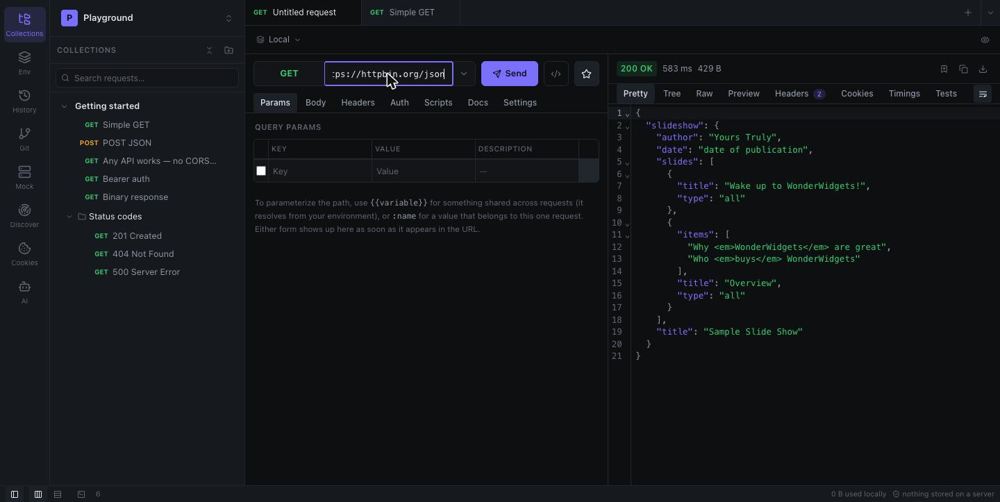
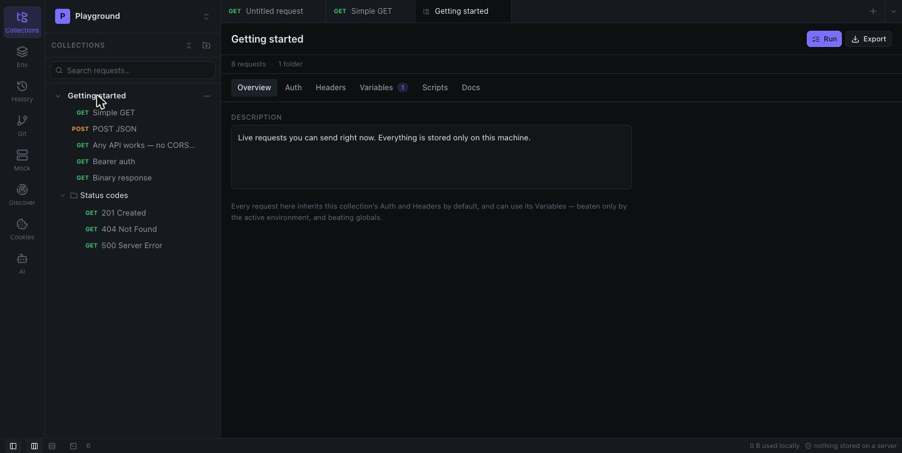
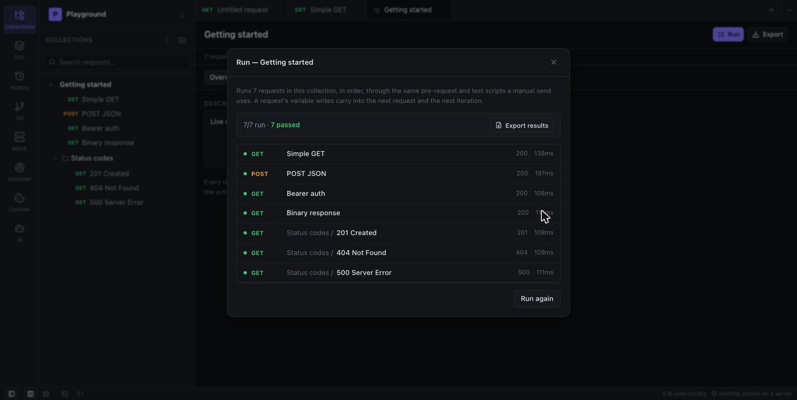
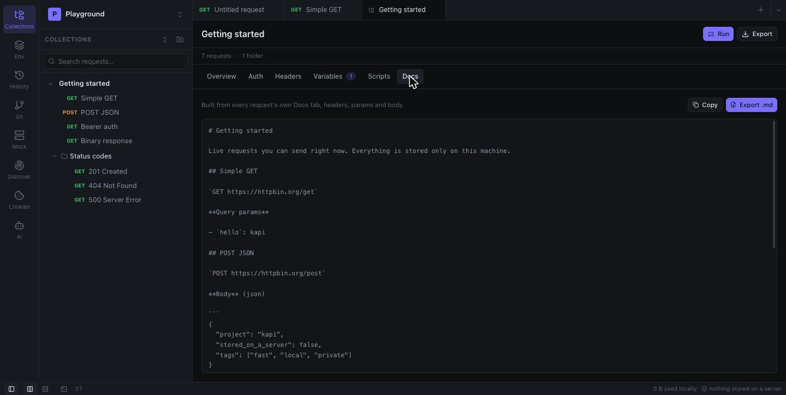

<h1 align="center">kapi</h1>

<p align="center"><strong>A Postman-grade API client that keeps its mouth shut.</strong></p>

<p align="center">
No account. No sync. No telemetry. No server anywhere in the loop.<br>
Your workspaces, collections, environments, secrets and history are files on <em>your</em> disk.
</p>

<p align="center">
  <a href="https://github.com/klejdi94/kapi/releases/latest">
    
  </a>
  <a href="https://github.com/klejdi94/kapi/releases/latest">
    
  </a>
  <a href="https://github.com/klejdi94/kapi/releases/latest">
    
  </a>
  <br>
  
  
  
</p>

<p align="center">
  
</p>

---

## Why another API client?

Because the good ones went to the cloud and took your requests with them.

- **Requests leave through your OS, not a browser.** No CORS to fight, no proxy in the middle — the
  same reach `curl` has.
- **Nothing is uploaded, ever.** Not your collections, not your tokens, not a usage ping. Everything
  lives in plain JSON files in your app data directory, which you can read, diff and back up.
- **Your AI, your account.** Ask Claude, Codex or Gemini — kapi shells out to whichever CLI you
  already have installed and signed in (picks automatically, lets you choose if more than one is
  around). No API key to paste, no extra subscription, nothing routed through us.
- **It starts instantly and stays out of the way.** A native window, not a browser pretending.

---

## Highlights

### Everything about a collection in one page

Default auth and headers every request inherits, variables (with a **secret** toggle that encrypts them
at rest with a key in your OS keychain and keeps them out of anything sent to the AI), collection-wide
scripts, and docs — no hunting through modals.

<p align="center">
  
</p>

### Run the whole thing

A collection or a single folder, for N iterations, optionally driven by a CSV data file — through the
exact pre-request → send → test pipeline a manual send uses, so a login request's token really does
carry into the requests after it. Every run is kept in a history you can revisit later, and results
export as JSON. The same pipeline runs headless from a terminal or CI — see below.

<p align="center">
  
</p>

### Contract tests for free

Import or sync an OpenAPI/Swagger spec and every response is checked against it — a documented
status, a body that matches the schema — in a manual send, the Runner and CI, without writing a test.

### Docs that write themselves

Markdown notes per request roll up into one document per collection — exportable as Markdown or
OpenAPI 3.0, ready to hand to anything that reads either.

<p align="center">
  
</p>

---

## What you get

<table>
<tr><td width="50%" valign="top">

**Every request you actually send**
All HTTP methods plus custom verbs. Bearer, Basic, API key, JWT (signed locally), a real OAuth 2.0
flow (opens your browser, PKCE included), AWS Signature V4, HTTP Digest, raw custom auth. JSON, XML, HTML, text, GraphQL, form-data
with real file uploads, urlencoded, binary — even over a client certificate. Mutual TLS, a custom CA,
an HTTP/SOCKS proxy, `text/event-stream` responses rendered live as they arrive, and WebSocket
connections with a live frame log.

</td><td width="50%" valign="top">

**Responses you can actually read**
Pretty-printed and highlighted, a collapsible JSON tree, raw bytes, real previews for HTML, images,
audio, video and PDFs, parsed cookies, header tables, timing breakdown. Save any response as a named
example — then diff a later response against it.

</td></tr>
<tr><td width="50%" valign="top">

**Organization that scales**
Workspaces → collections → nested folders → requests. Drag-and-drop, multi-select, pinned favourites
and pinned tabs, inherited auth/headers/variables, `{{variables}}` resolved across environments,
collection scope and globals — with a diff view for comparing two environments.

</td><td width="50%" valign="top">

**Scripting, the Postman way**
Pre-request and test scripts with the `pm` API you already know — chai-style `pm.expect`,
`pm.response.to.have.status`, `pm.sendRequest`, `pm.iterationData`, even legacy `postman.*` and
`tests[…]`, and `require()` of lodash, crypto-js, moment, uuid and xml2js — per request *and* per
collection, running in that order. Scripts run in a sandbox with
no access to your files or the app, so an imported collection can't do more than send requests.

</td></tr>
<tr><td width="50%" valign="top">

**An AI that sees what you see**
Claude, Codex or Gemini — whichever you have installed — answers with the request and response you
have open already attached — *"why did this fail?"*, *"write a pre-request script for this"* — and
writes `pm.test(...)` assertions from a real response. Generated scripts drop straight into the
request.

</td><td width="50%" valign="top">

**Discover an API by browsing it**
Point kapi at a site; it opens in its own window with your real session and quietly watches the calls
it makes while you click around. What it finds becomes a collection — paths templated, duplicates
merged, secrets swapped for `{{variables}}`. Or skip it: kapi probes `/openapi.json` first.

</td></tr>
<tr><td width="50%" valign="top">

**A browser-grade cookie jar**
`Set-Cookie` responses are captured and sent back automatically to matching hosts — for manual sends
*and* runner executions — with a panel to inspect or clear them.

</td><td width="50%" valign="top">

**GraphQL that knows the schema**
Fetch a schema by introspection, browse its queries and mutations, insert a starter query with a
click — authenticated the same way the real calls are.

</td></tr>
<tr><td width="50%" valign="top">

**A local mock server**
Turn any collection into a running HTTP server on localhost with per-route status, headers, body and
latency, then watch the hits stream into the console.

</td><td width="50%" valign="top">

**Git-backed workspaces**
Point a workspace at a folder and kapi keeps a clean JSON snapshot in it, with a built-in diff view,
commit, push and pull. Review API changes in a pull request like code. Secrets stay out of the snapshot.

</td></tr>
<tr><td width="50%" valign="top">

**Import and export everything**
Postman v2.1, OpenAPI 3.x / Swagger 2 (JSON or YAML, auto-foldered by tag), HAR, Insomnia, plain cURL —
paste a curl command into the URL bar and it expands into a full request. Export to Postman, OpenAPI
3.0, Markdown docs or HAR, or generate ready-to-run code in a dozen languages.

</td><td width="50%" valign="top">

**Small things that add up**
Autosave on every edit. A JWT/SAML inspector. Save any response value as a variable in one click.
Edit headers or query params as plain text when a grid is slower than typing, and import a `.env`
file straight into an environment. ⌘K command palette. Update in place from inside the app instead
of a fresh download. A console that shows the whole truth — every request, response, WebSocket
frame, mock hit and script log, with full headers and bodies.

</td></tr>
<tr><td width="50%" valign="top">

**gRPC, without generated code**
Point kapi at a server with reflection, or at your `.proto` files, pick a method, and send JSON.
Unary, server-streaming, client-streaming and bidirectional calls, metadata, deadlines, TLS and mTLS —
streamed responses appear message by message.

</td><td width="50%" valign="top">

**Load testing built in**
Run a collection with dozens of virtual users for a duration or a number of iterations, with ramp-up
and think time. Live throughput, p50/p95/p99 latency and error rate, per request — and the same from
`npx kapi load` with pass/fail thresholds for CI.

</td></tr>
<tr><td width="50%" valign="top">

**A response that's a table or a chart, when it is one**
A JSON array of objects, or a CSV body, gets a real sortable table and a bar/line chart for free —
pick the columns, export the table back out as CSV. Hidden entirely when a response isn't shaped
like data, same as Preview only shows up for things it can actually render.

</td><td width="50%" valign="top">

**A workspace overview, not just a blank tab**
Close every tab and you land on a real page instead of nothing: pass/fail rate, requests-per-day
sparkline, and a feed of recent runs and OpenAPI syncs across the whole workspace — most of it fed
by an AI CLI working through kapi's MCP server rather than typed by hand.

</td></tr>
<tr><td width="50%" valign="top">

**Secrets that never live in kapi**
Point a variable at `op://vault/item/field`, `awssm://secret#key` or `vault://path#field` and kapi
reads it with the 1Password, AWS or Vault CLI you're already signed in to, right before each request.
Each reference asks for your permission once, in a native dialog no script or import can skip.

</td><td width="50%" valign="top">

**Monitors, and staging vs. production**
Schedule a collection every few minutes while kapi is open and get a system notification when it
starts failing — or export it as a GitHub Actions workflow for when it's closed. Send any request
through two environments side by side and see exactly what differs, volatile headers hidden.

</td></tr>
</table>

---

## Run collections from a terminal or CI

The same pre-request → send → test pipeline the GUI's "Run collection" uses, headless — no window,
no app instance, just Node reading the files kapi already exports:

```bash
npx kapi run my-collection.kapi.json --env staging.json --iterations 5 --data users.csv
```

Takes a kapi-native (`.kapi.json`) or Postman v2.1 collection export, an optional kapi or Postman
environment export, and an optional CSV data file (one row per iteration, same as the GUI runner).
Exits `0` only when every request's tests passed and none errored — `1` on a test failure, `2` on a
usage/config problem — so it drops straight into a CI step. `--json` prints one JSON object instead
of the human-readable summary. `--folder <name>` scopes the run the same way right-clicking a folder
does in the app. Cookies carry between requests like in the app, `--globals` loads globals, and
`--export-environment` / `--export-globals` write the variables back out as the run left them.

Load test the same collection with concurrent virtual users, and fail the build on a regression:

```bash
npx kapi load my-collection.kapi.json --env staging.json --vus 50 --duration 2m --ramp-up 30s \
  --threshold "p95<400" --threshold "errors<1"
```

Catch slowdowns between builds: save a baseline on `main`, compare pull requests against it.

```bash
npx kapi run api.kapi.json --iterations 10 --save-baseline perf-baseline.json      # on main
npx kapi run api.kapi.json --iterations 10 --baseline perf-baseline.json --fail-on-regression
```

---

## Let an AI CLI drive kapi

kapi ships its own [MCP](https://modelcontextprotocol.io) server — Claude Code, Codex or Gemini can
create requests, run a test battery, and keep a collection in sync with a backend's OpenAPI/Swagger
spec over time, directly in your workspace. Nothing about the AI CLI's own credentials is ever
touched; kapi only reads and writes the same JSON files the app itself uses.

```bash
npx kapi mcp install
```

Registers `kapi` on whichever of `claude`/`codex`/`gemini` is on your PATH, and installs a companion
skill for Claude Code so it knows the right order of operations without being told each time. Then,
from any backend project's own terminal:

> "Use kapi to test this API — import its OpenAPI spec and run the tests."

If no workspace exists yet, the AI is guided step by step to create one rather than failing. If kapi
is already open, bring its window to the front after a change — it notices and reloads automatically
rather than risking a stale save overwriting what was just built.

---

## Install

Grab the latest build for **macOS** (Apple Silicon or Intel), **Windows x64**, or **Linux** (AppImage
or `.deb`) from the [Releases](https://github.com/klejdi94/kapi/releases/latest) page. kapi checks
for updates on launch and can fetch and install a new one in place — see **Check for Updates…** in
the Help menu.

<details>
<summary><strong>First launch on an unsigned build</strong></summary>

<br>

kapi isn't signed with a paid Apple Developer certificate, so both systems question it once.

**macOS** — open the `.dmg`, drag kapi to Applications, then right-click the app and choose **Open**
(double-clicking is refused the first time). If macOS instead claims the app *"is damaged and can't be
opened"*, it isn't — that message means the download carries a quarantine flag:

```
xattr -cr /Applications/kapi.app
```

**Windows** — SmartScreen shows a warning: **More info → Run anyway**.

**Keychain prompt** — secret variables are encrypted with a key kept in your OS keychain. On macOS,
an unsigned build may ask once after each update whether kapi can use it; choose **Always Allow**.
If the keychain isn't available (for example a Linux desktop without a Secret Service), kapi says so
and keeps secrets in its data files as before.

</details>

---

## Develop

```bash
npm install
npm run desktop:dev     # native window + Vite dev server, hot reload
```

`npm run dev` (plain Vite in a browser tab) is fine for fast UI iteration, but requests to other
origins hit normal browser CORS restrictions there — only the desktop shell bypasses them.
`desktop:dev` writes to a `dev` subfolder of kapi's own app-data directory, so it never touches (or
gets confused with) a real installed build's data.

```bash
npm run desktop:build   # bundle into src-tauri/target/release/bundle/
npm run typecheck       # tsc --noEmit
npm test                # vitest — pure-logic modules, stores and the script sandbox
npm run test:e2e        # Playwright UI smoke tests against the production build
npm run build:npm       # the `npx kapi` CLI + MCP bundle, in npm/dist
npm run cli -- run …    # the CLI straight from source
```

On macOS, building the `.dmg` needs `hdiutil` to mount a disk image, which some sandboxed shells
block — if that step fails the `.app` itself is still valid, or you can let CI build it.

Every push and pull request runs typecheck, tests, a frontend build and a smoke test of the npm
bundle, plus `cargo fmt`, `clippy` and `cargo test` for the Rust side. See
[CONTRIBUTING.md](CONTRIBUTING.md) for more.

**Releases.** Pushing a tag builds macOS (Apple Silicon + Intel), Windows, and Linux installers on
GitHub's runners and attaches them to a draft release; publishing the draft also publishes
`npx kapi`. The whole flow, including optional code signing, is in [docs/RELEASING.md](docs/RELEASING.md).

---

## Stack

[Tauri 2](https://v2.tauri.app) (Rust shell, native HTTP) · React 19 · TypeScript · Vite · Tailwind ·
Zustand · CodeMirror 6. No backend, because there is nothing to put on one.
